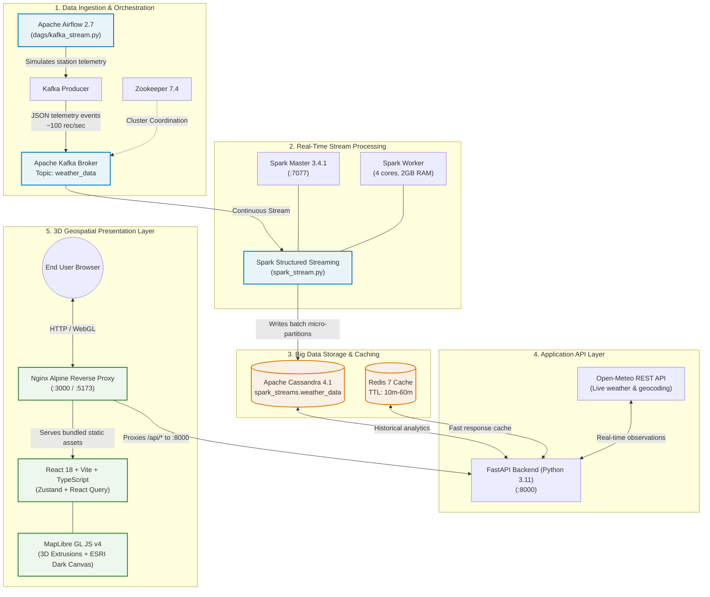

# 🌦️ India Weather Map - 3D Real-Time Geospatial & Big Data Platform

[](https://fastapi.tiangolo.com)
[](https://react.dev)
[](https://kafka.apache.org)
[](https://spark.apache.org)
[](https://cassandra.apache.org)
[](https://airflow.apache.org)
[](https://redis.io)
[](https://maplibre.org)
[](https://www.docker.com)

A distributed, end-to-end real-time Big Data and geospatial analytics platform. The system ingests and processes high-velocity meteorological streams using **Apache Kafka** and **Apache Spark Structured Streaming**, persists time-series observations in **Apache Cassandra**, and serves high-performance APIs via **FastAPI** to an interactive **3D WebGL weather map of India** powered by **MapLibre GL JS** and **React**.

> ⚡ **Quick Run**: See [RUN_COMMANDS.md](RUN_COMMANDS.md) for copy-paste ready commands to launch the application with Docker or locally.

---

## 📑 Table of Contents

- [System Architecture](#-system-architecture)
- [Component Catalog](#-component-catalog)
- [Interactive Features](#-interactive-features)
- [Quick Start: Running with Docker Compose](#-quick-start-running-with-docker-compose)
- [Web UIs & Port Catalog](#-web-uis--port-catalog)
- [Standalone Local Development](#-standalone-local-development)
- [Cassandra Schema & Big Data Pipeline](#-cassandra-schema--big-data-pipeline)
- [API Endpoints Reference](#-api-endpoints-reference)
- [Repository Structure](#-repository-structure)
- [Troubleshooting & Gotchas](#-troubleshooting--gotchas)

---

## 🏗️ System Architecture

The platform separates ingestion/streaming (the Big Data pipeline) from low-latency querying and 3D geospatial rendering (the user-facing application stack).



---

## 🧩 Component Catalog

### 1. Presentation Layer (Frontend)
* **Framework**: React 18, TypeScript, Vite.
* **Map Engine**: MapLibre GL JS v4 with hardware-accelerated 3D WebGL rendering.
* **Map Style**: Custom high-contrast dark theme utilizing **ESRI World Dark Gray Canvas** base tiles (no watermark, zero API key constraints).
* **State Management**: **Zustand** (synchronizes viewport, selected geography, drawers, and camera fly-to animations) and **TanStack React Query** (intelligent request caching and deduping).
* **Styling**: Tailwind CSS with custom slate palette, translucent glassmorphic blur cards (`backdrop-blur-md`), and CSS animations.
* **Reverse Proxy**: Nginx Alpine container forwarding `/api/` traffic to `backend:8000` and responding to `/health` probes.

### 2. Application Layer (Backend)
* **Framework**: FastAPI (Python 3.11) on Uvicorn with asynchronous endpoints.
* **Data Validation**: Pydantic v2 schemas providing strict type guarantees and graceful defaults for Indian Union Territories and regional boundaries.
* **Clients**:
  * `OpenMeteoClient`: Asynchronous HTTP client requesting meteorological forecasts and Indian geocoding.
  * `CassandraClient`: Resilient cluster connection pool that auto-bootstraps the `spark_streams` keyspace and `weather_data` table on startup.
  * `CacheService`: Redis caching layer with TTL expiration (10 min current conditions, 30 min forecast, 60 min historical data).

### 3. Big Data & Streaming Pipeline
* **Apache Kafka & Zookeeper (Confluent 7.4.0)**: Fault-tolerant distributed message broker queuing meteorological station messages on the `weather_data` topic.
* **Confluent Control Center**: Full cluster visibility, consumer lag tracking, and topic payload inspection UI.
* **Apache Spark 3.4.1 (Master, Worker, and Streaming Job)**:
  * Reads JSON telemetry from Kafka.
  * Applies schema transformations, casting, and timestamp conversions.
  * Streams micro-batches into Apache Cassandra via the `spark-cassandra-connector_2.12:3.4.1`.
* **Apache Cassandra 4.1**: Distributed columnar database partitioned by `(city, timestamp DESC)` for fast time-series analytical lookups.
* **Apache Airflow 2.7.0**: Orchestrates hourly simulated weather station telemetry generators (`dags/kafka_stream.py`) with PostgreSQL metadata storage.

---

## ✨ Interactive Features

| Feature | Description |
| :--- | :--- |
| **3D State Extrusions** | All 36 Indian states and union territories render as extruded 3D polygons where the height (up to 300km) is dynamically calculated from real-time temperature. |
| **Color Temperature Scale** | Gradient interpolation mapping: Deep Blue ($-10^\circ\text{C}$) $\to$ Cyan ($10^\circ\text{C}$) $\to$ Green ($20^\circ\text{C}$) $\to$ Amber ($30^\circ\text{C}$) $\to$ Red ($40^\circ\text{C}+$). |
| **3-Level Geographic Drill-down** | Navigate seamlessly from **National (India Overview)** $\to$ **State Boundaries** $\to$ **City/Coordinate Telemetry**. |
| **Live Weather Drawer** | Slide-out dashboard presenting current temperature, feels-like temperature, humidity, atmospheric pressure, wind direction, and precipitation. |
| **Forecast & Charts** | 48-hour hourly breakdowns, 7-day daily trends, and historical temperature charts powered by Recharts. |
| **Debounced Indian Geocoding** | Instant search bar with keyboard navigation (`↑`/`↓`/`Enter`) restricted to Indian localities (`country_code=IN`). |

---

## 🚀 Quick Start: Running with Docker Compose

### Prerequisites
* [Docker Desktop](https://www.docker.com/products/docker-desktop/) (Windows / macOS / Linux) with Docker Compose v2+.
* At least **8 GB RAM** allocated to Docker Desktop (to run Spark, Kafka, Cassandra, Airflow, and Web containers concurrently).

### 1. Clone & Start All Services
```bash
# Clone the repository
git clone https://github.com/lucifer4330k/weatherpulse.git
cd weatherpulse

# Start all containers in detached mode
docker compose up -d
```

### 2. Verify Container Health
Wait 30–60 seconds for Cassandra and Kafka to pass initial health checks:
```bash
docker compose ps
```
You should see all containers listed with status `Up` or `Up (healthy)`:
* `weather-frontend`
* `weather-backend`
* `cassandra`
* `broker`
* `zookeeper`
* `spark-master`
* `spark-worker`
* `spark-streaming`
* `redis`
* `airflow-webserver`
* `airflow-scheduler`
* `postgres`

### 3. Open the Application
Open your web browser and navigate to:
* **[http://127.0.0.1:3000](http://127.0.0.1:3000)** *(Recommended)*
* Or **[http://localhost:5173](http://localhost:5173)**

> [!TIP]
> **Windows Note**: On some Windows machines, a system background process (`dllhost.exe`) listens on IPv6 loopback `[::1]:3000`. If `http://localhost:3000` appears blank or hangs, use **`http://127.0.0.1:3000`** or **`http://localhost:5173`** directly.

---

## 🌐 Web UIs & Port Catalog

| Service | Address | Credentials | Purpose |
| :--- | :--- | :--- | :--- |
| **Weather Map Frontend** | [http://127.0.0.1:3000](http://127.0.0.1:3000) or [:5173](http://localhost:5173) | *None* | Interactive 3D India Weather Map |
| **FastAPI Swagger Docs** | [http://localhost:8000/docs](http://localhost:8000/docs) | *None* | Interactive API documentation |
| **FastAPI ReDoc** | [http://localhost:8000/redoc](http://localhost:8000/redoc) | *None* | Alternative API spec viewer |
| **Airflow Webserver** | [http://localhost:8080](http://localhost:8080) | `admin` / `admin` | Pipeline orchestration & DAG triggers |
| **Kafka Control Center** | [http://localhost:9021](http://localhost:9021) | *None* | Kafka topic monitoring & consumer lag |
| **Spark Master Web UI** | [http://localhost:9090](http://localhost:9090) | *None* | Spark cluster status & active jobs |
| **Schema Registry** | [http://localhost:8081](http://localhost:8081) | *None* | Confluent Schema Registry |

---

## 💻 Standalone Local Development

If you wish to run individual components locally outside Docker containers:

### 1. Running Backend Locally
```bash
cd backend
python -m venv venv

# Activate virtual environment
# Windows:
.\venv\Scripts\activate
# Linux/macOS:
source venv/bin/activate

# Install dependencies
pip install -r requirements.txt

# Run development server
uvicorn app.main:app --reload --port 8000
```

### 2. Running Frontend Locally
```bash
cd frontend

# Install Node modules
npm install

# Run Vite development server
npm run dev
# Accessible at http://localhost:5173
```

### 3. Running Spark Streaming Locally
```bash
# Requires Apache Spark 3.4.1 installed locally and on PATH
spark-submit \
  --master local[*] \
  --packages org.apache.spark:spark-sql-kafka-0-10_2.12:3.4.1,com.datastax.spark:spark-cassandra-connector_2.12:3.4.1 \
  spark_stream.py
```

---

## 🗄️ Cassandra Schema & Big Data Pipeline

### Cassandra Keyspace & Table Definition
The keyspace `spark_streams` and table `weather_data` are automatically created on startup:
```sql
CREATE KEYSPACE IF NOT EXISTS spark_streams
WITH replication = {'class': 'SimpleStrategy', 'replication_factor': 1};

CREATE TABLE IF NOT EXISTS spark_streams.weather_data (
    station_id text,
    timestamp timestamp,
    city text,
    state text,
    latitude double,
    longitude double,
    temperature double,
    humidity int,
    pressure double,
    wind_speed double,
    precipitation double,
    weather_code int,
    weather_description text,
    PRIMARY KEY (city, timestamp)
) WITH CLUSTERING ORDER BY (timestamp DESC);
```

### Querying Cassandra via CLI
```bash
# Connect to CQLSH inside the Cassandra container
docker exec -it cassandra cqlsh -u cassandra -p cassandra

# Inspect record count and sample data
SELECT COUNT(*) FROM spark_streams.weather_data;
SELECT city, timestamp, temperature, humidity, wind_speed FROM spark_streams.weather_data LIMIT 10;
```

---

## 🔌 API Endpoints Reference

All endpoints support both `/` and `/api/` route prefixes:

### Health Probes
* `GET /api/health`: Full health check querying Cassandra, Redis, and Open-Meteo.
* `GET /api/ready`: Kubernetes readiness probe.
* `GET /api/live`: Kubernetes liveness probe.

### Geocoding
* `GET /api/geocode?q={city}&limit=5`: Search for Indian cities and locations.
* `GET /api/geocode/reverse?lat={lat}&lon={lon}`: Reverse geocodes coordinates.

### Weather Telemetry & Analytics
* `GET /api/weather/current?lat={lat}&lon={lon}`: Live temperature, humidity, wind, and conditions.
* `GET /api/weather/forecast?lat={lat}&lon={lon}&hours=48&days=7`: Hourly & daily forecast.
* `GET /api/weather/dashboard?lat={lat}&lon={lon}&name={name}`: Full dashboard bundle.
* `GET /api/weather/historical?lat={lat}&lon={lon}&days=30`: 30-day weather trends.
* `GET /api/weather/alerts?lat={lat}&lon={lon}`: Extreme condition warnings.

### India Meteorological Summaries
* `GET /api/india/overview`: State-by-state temperature map and national averages.
* `GET /api/india/state/{state_code}`: In-depth metrics for a specific state code (e.g. `MH`, `DL`, `KA`).
* `GET /api/india/state/{state_code}/districts`: Regional district centers.

### Cassandra Big Data Queries
* `GET /api/cassandra/historical?city={city}&days=30`: Analytical time-series directly from Cassandra.
* `GET /api/cassandra/latest?city={city}`: Most recent stream entry.
* `GET /api/cassandra/cities`: List of cities populated in the Cassandra keyspace.

---

## 📁 Repository Structure

```
kafka-spark-cassandra/
├── frontend/                    # React 18 + Vite + TypeScript application
│   ├── src/
│   │   ├── components/          # MapContainer, WeatherDashboard, SearchBar
│   │   ├── hooks/               # useWeather, useGeocode React Query hooks
│   │   ├── services/            # mapUtils.ts (ESRI basemap, 3D styles), api.ts
│   │   ├── store/               # useAppStore.ts (Zustand state)
│   │   └── types/               # TypeScript interfaces
│   ├── nginx.conf               # Production Nginx reverse proxy configuration
│   ├── Dockerfile               # Multi-stage frontend container build
│   └── README.md                # Dedicated frontend documentation
│
├── backend/                     # FastAPI REST API service
│   ├── app/
│   │   ├── routers/             # health, geocode, weather, india, cassandra
│   │   ├── services/            # open_meteo.py, cassandra_client.py, cache.py
│   │   ├── models/              # Pydantic schemas (weather.py, location.py)
│   │   └── main.py              # Application factory & lifespan handlers
│   ├── Dockerfile               # Optimized Python 3.11-slim container
│   ├── requirements.txt         # Production backend dependencies
│   └── README.md                # Dedicated backend documentation
│
├── dags/                        # Apache Airflow orchestration
│   ├── kafka_stream.py          # Weather telemetry generator DAG
│   └── README.md                # Airflow DAG documentation
│
├── script/
│   └── entrypoint.sh            # Airflow container initialization script
│
├── spark_stream.py              # PySpark Structured Streaming consumer job
├── docker-compose.yml           # Full multi-container stack definition
├── PROJECT_SPEC.md              # Technical design specification
└── README.md                    # Master documentation (this file)
```

---

## 🛠️ Troubleshooting & Gotchas

### 1. Blank Screen or Connection Error on `localhost:3000`
* **Root Cause**: Windows system host processes (`dllhost.exe`) frequently occupy `[::1]:3000` on Windows 10/11, intercepting IPv6 browser traffic.
* **Solution**: Navigate to **[http://127.0.0.1:3000](http://127.0.0.1:3000)** (direct IPv4 loopback) or **[http://localhost:5173](http://localhost:5173)**.

### 2. MapLibre 3D Styles Not Rendering
* **Root Cause**: Invalid Mapbox-specific layers (like `sky`) or missing properties in GeoJSON layers can cause MapLibre's style validator to reject the style sheet.
* **Solution**: Handled automatically in `mapUtils.ts` by using the standard raster ESRI Dark Canvas basemap and wrapping property lookups in `['coalesce', ['get', 'property'], default]`.

### 3. Cassandra Connection Refusal on First Boot
* **Root Cause**: Cassandra 4.1 requires 30–45 seconds to initialize storage engines and bind to port `9042`.
* **Solution**: The `docker-compose.yml` specifies `healthcheck: test: ["cqlsh", "-e", "describe keyspaces"]` and `backend` depends on `cassandra: condition: service_healthy`. The backend automatically retries with exponential backoff.

### 4. Spark Worker Resource Allocation
* **Root Cause**: Spark Structured Streaming with Kafka and Cassandra connectors requires at least 2 cores and 1.5 GB memory to execute streaming micro-batches.
* **Solution**: The `spark-worker` service is pre-configured with `SPARK_WORKER_CORES: 4` and `SPARK_WORKER_MEMORY: 2g`.

---

## 📄 License

This project is licensed under the **MIT License** — see the [LICENSE](LICENSE) file for details.